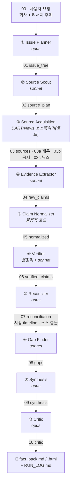

# Evidence-grounded Multi-agent Research Assistant

컨설팅형 기업 리서치를 위한 **근거 기반 멀티에이전트 리서치 어시스턴트**.
교수님 인턴 프로젝트 가이드(`consulting_research_agent_intern_guide.html`)의 8-에이전트 워크플로우를
DART OpenAPI(정형+비정형)와 네이버 뉴스 API 위에 그대로 구현한 **동작하는 데모**입니다.

> 목표는 "그럴듯한 요약"이 아니라, 시니어가 바로 리뷰할 수 있는 **fact pack** —
> 각 주장(claim)이 출처·근거 문구(source_span)·검증상태를 달고 있는 1차 리서치 산출물.

---

## 무엇을 하나

사용자 요청(회사 + 리서치 주제)을 받아 9단계 파이프라인을 실행하고,
`outputs/<run_id>/` 에 **단계별 중간 산출물**과 최종 fact pack(md/html), 실행 리포트(RUN_LOG)를 남깁니다.
지금 당장 **팩트체크 가능한 최신 흐름**을 보는 게 목적이라, DART는 **가장 최신 정기보고서 2개(예: 사업보고서
2025.12 + 분기보고서 2026.03)** 를 시점축으로 함께 읽고, 뉴스는 최근 기사만 붙입니다.



각 산출물이 **누가(에이전트) → 무엇을 받아 → 무엇을 내는지**:

| # | 산출물 | 담당(누가) | 역할 (입력 → 출력) |
|---|---|---|---|
| 00 | `00_request.json` | — | 사용자 입력(회사·주제·기간) |
| 01 | `01_issue_tree.json` | **Issue Planner** (opus) | 요청 → 검증할 이슈7 + 가설 (요청 재진술 금지) |
| 02 | `02_source_plan.json` | **Source Scout** (sonnet) | 이슈 → DART 앵커/뉴스 검색어 (+도메인 앵커팩) |
| 03 | `03_sources.json` (+03a/b/c) | **Source Acquisition** (코드) | 계획 → DART 정형+비정형(최신 2시점)·뉴스 원문 |
| 04 | `04_raw_claims.json` | **Evidence Extractor** (sonnet) | 원문 → atomic claim (source_span 필수) |
| 05 | `05_normalized_claims.json` | **Claim Normalizer** (결정적) | enum 표준화 + 동일소스 중복 병합 |
| 06 | `06_verified_claims.json` | **Verifier** (결정적+sonnet) | claim이 span에 근거하는지 판정(verified/weak/unsupported) |
| 07 | `07_reconciliation.json` | **Reconciler** (opus) | **의미적 그룹핑 + 시점 timeline + 소스 충돌 표면화** |
| 08 | `08_gaps.json` | **Gap Finder** (sonnet) | 비어있는 근거·비교축 + next check |
| 09 | `09_synthesis.json` | **Synthesis** (opus) | verified+timeline+gap → fact pack 초안(10섹션) |
| 10 | `10_critic.json` | **Critic** (opus) | 과장·비약·누락 자기비평 |
| — | `fact_pack.md/.html` · `RUN_LOG.md` | Report (코드) | 최종 렌더 + 실행/한계 리포트 |

> ⑤ Normalizer는 **결정적**(같은 소스의 거의 동일 텍스트만 병합)이라 얕다. "DART 30조 ≈ 뉴스 30조 돌파"처럼
> **소스·시점이 다른 같은 사실**의 정합은 의미 판단이 필요하므로 **⑦ Reconciler(LLM)** 가 맡는다 —
> 핵심 지표를 시점축으로 정렬하고(2025-12 → 2026-03 → 뉴스), 값이 어긋나면 `값충돌`/`시점차이`/`공시vs뉴스`로 표시한다.

## 데이터 소스

| 소스 | 종류 | 사용 | 엔드포인트 |
|---|---|---|---|
| DART 주요계정 | 정형(JSON) | 신뢰 기준선 재무 (자산/부채/자본/매출/영업이익/순이익) | `fnlttSinglAcnt.json` |
| DART 공시목록 | 정형(JSON) | 최신 정기보고서·단일판매/공급계약 탐지 | `list.json` |
| DART 정기보고서 원문 | 비정형(XML→text) | 수주상황·방산·미국사업·업황 근거 문단 (**최신 2시점**) | `document.xml` (zip) |
| 네이버 뉴스(검색) | 비정형(JSON) | 후보 기사 검색 (관련성 필터 후) | `openapi.naver.com/v1/search/news.json` |
| 네이버 뉴스(원문) | 비정형(HTML→text) | 기사 **본문** 파싱해 claim 근거 확보 | `n.news.naver.com` 기사 페이지 |

- **최신성**: 사업보고서만이 아니라 **가장 최근 정기보고서 2개(분기/반기/사업)** 를 시점축으로 함께 읽어,
  같은 지표의 흐름(예: 수주잔고 2025-12-31 → 2026-03-31)을 만든다. 재무도 최신 연간보고서에서 자동 도출.
- DART 원문은 **utf-8 → cp949 폴백** 디코딩(구형 보고서 대비), **zip 내 다중 XML 전체를 병합**(본문이
  namelist()[0]이 아닌 경우 대비) 후 태그 제거.
- 원문 발췌는 **숫자 밀도 랭킹**으로 실제 표(수주잔고 등)를 우선 선택. 수주표는 `기납품액` 앵커로 고정 포착.
- 뉴스는 **회사명 필수 + 토픽어 1개 이상** 매칭만 통과(정확도 우선).
- 검색 API는 title+요약 스니펫만 주므로, **네이버 뉴스로 제공된 기사는 원문 페이지를 직접 받아
  본문(`#dic_area` 등)을 파싱**해 근거로 사용한다. 외부 매체(원문 링크)는 구조가 제각각이라
  스니펫으로 안전하게 폴백한다(RUN_LOG에 `원문파싱 N건`으로 집계).

## 실행

```bash
# 1) 의존성
pip install -r requirements.txt

# 2) 키 설정 (.env — 저장소 루트 또는 상위 모노레포 루트)
cp .env.example .env   # DART_API_KEY / ANTHROPIC_API_KEY (필수), NAVER_CLIENT_ID+SECRET (뉴스)

# 3) 데모 실행 (기본: 한화오션)
python scripts/run_demo.py
# 고정 폴더명으로(커밋용 데모): --out-name demo
python scripts/run_demo.py --company 한화오션 --topic "2026년 수주잔고 흐름 및 향후 사업 전망" --out-name demo
```

산출물: `outputs/<run_id>/` (커밋되는 예시 런은 [`outputs/demo/`](outputs/demo/))
- `00_request.json` … `10_critic.json` — 단계별 중간 산출물 (각 에이전트의 raw 출력)
- `07_reconciliation.json` — 시점 timeline · 소스 충돌 (Reconciler)
- `fact_pack.md` / `fact_pack.html` — 최종 fact pack (10섹션)
- `RUN_LOG.md` — **각 단계가 무엇을 냈고 어떤 한계가 있었는지** + 원시 로그

> 저장소에는 **최신 예시 런 하나(`outputs/demo/`)만** 커밋합니다. 타임스탬프 런(`outputs/한화오션_20...`)은
> `.gitignore` 처리되어 로컬에만 쌓입니다(리포 혼잡 방지).

## 모델

- 고volume 추출/검증: `claude-sonnet-5`
- 종합/비평: `claude-opus-4-8`
- `AIC_MODEL_FAST` / `AIC_MODEL_SMART` 환경변수로 교체 가능.

## 알려진 한계 (요약)

- **네이버 뉴스**: `X-Naver-Client-Id` + `X-Naver-Client-Secret` **둘 다** 필요하고, 개발자센터에서
  해당 앱에 **검색(Search) API가 활성화**돼 있어야 함(미활성 시 `Scope Status Invalid`). 인증이 안 되면
  뉴스 소스는 0건으로 degrade하고 파이프라인은 DART만으로 완주합니다(RUN_LOG에 명시).
- **뉴스 원문 파싱**: 네이버 뉴스로 제공된 기사만 본문 파싱이 안정적. 외부 매체는 스니펫 폴백이라
  근거 깊이가 얕음. 본문 추출은 휴리스틱(주요 컨테이너 선택)이라 광고/캡션이 섞일 수 있음.
- DART 원문은 **키워드 앵커 주변 발췌**(문서의 일부)만 사용 → 앵커 밖 사실은 못 봄. 최신 정기보고서
  2개 시점을 읽지만 여전히 전체 청킹은 아님.
- 표가 플레인텍스트로 분해되면 숫자-라벨 매칭이 흔들릴 수 있음(Verifier가 span 실재성으로 1차 차단).
- **Reconciler(시점 정합)**: 의미적 그룹핑·충돌 판정을 **LLM**이 하므로(임베딩/규칙 아님) 경계사례가 흔들릴 수
  있고, 근거 claim의 `source_date`(보고 기준일) 품질에 의존. 뉴스가 대부분 정성적이라 timeline은 DART 수치 위주.
- **Normalizer 중복 병합은 결정적이라 얕음** — 교차소스 의미 중복은 Reconciler가 별도로 처리.
- Critic은 자기비평이라 자체 편향을 공유할 수 있음(외부 검토 대체 아님).

자세한 배경/설계/측정은 [`docs/`](docs/) 및 [`AGENTS.md`](AGENTS.md) 참고.
